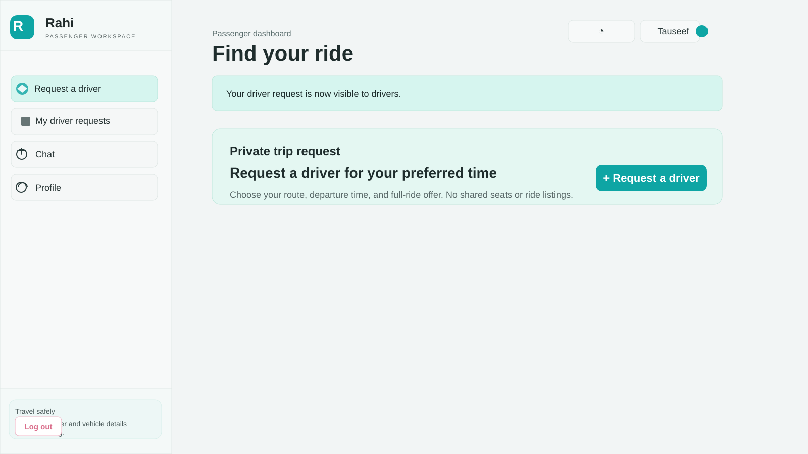
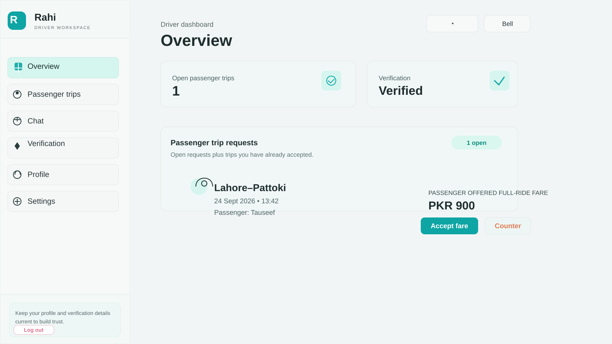

# Drivo API

Backend for a Lahore–Pattoki intercity ride-sharing MVP.

## Overview

This project powers a ride-sharing platform for intercity travel, with separate passenger and driver workspaces for booking seats, posting rides, accepting requests, verifying accounts, and handling real-time trip updates.

## Setup

1. Copy `.env.example` to `.env` and set `MONGODB_URI`.
2. Install dependencies with `npm install`.
3. Start the API with `npm run dev` (or `npm start`).

The health endpoint is `GET /api/health`.

## Authentication

- `POST /api/auth/register` registers a driver or passenger and returns a JWT.
- `POST /api/auth/login` returns a JWT for a registered user.

Use the returned token on protected endpoints as `Authorization: Bearer <token>`.

Phase 2 includes JWT authentication. Set a long, random `JWT_SECRET` in `.env`.

## Rides and requests

- `POST /api/rides` — driver only; creates a ride.
- `GET /api/rides?route=Lahore-Pattoki` — lists active rides for a route.
- `POST /api/requests` — passenger only; requests a seat with `{ "rideId": "..." }`.
- `PATCH /api/requests/:id` — driver only; accepts or rejects with `{ "status": "accepted" }` or `{ "status": "rejected" }`.
- `GET /api/requests/mine` — lists the current passenger's requests or the current driver's incoming requests.

## Workspace previews

### Passenger workspace

### Driver workspace

